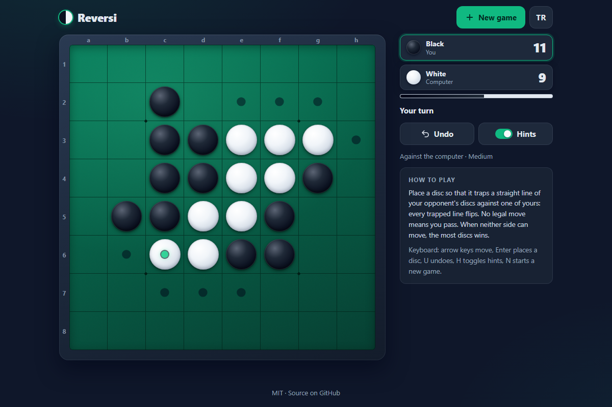

# Reversi - flip your way to the bigger half of the board, against the computer or a friend

[](#tests)
[](LICENSE)

**▶ Play now: https://celaldrg.github.io/reversi/**



## Features

- The complete rules: captures in all eight directions, automatic passes, game end and winner. The move generator is checked against known perft counts.
- A computer opponent with three levels: **Easy** (one move ahead plus a little seeded randomness), **Medium** (3-ply alpha-beta search) and **Hard** (iterative deepening for about a second, and a perfect solve of the last 10 empty squares).
- The computer thinks in a Web Worker, so the page never freezes; a pulsing indicator shows that it is thinking.
- Two players on one device, or play the computer as Black or White.
- Undo: one move in two-player mode; against the computer it goes back to your previous turn.
- Legal-move hints (can be switched off), a last-move marker, a live score with a balance bar, and notices for passes and the result.
- Discs flip in 3D, one after another; reduced-motion settings are respected.
- Mouse, touch and keyboard. Mobile-first layout from small phones (portrait or landscape) up to desktop.
- English and Turkish interface. Language, hints and the last game settings are remembered (and private mode does not break anything).
- Plain HTML, CSS and JavaScript modules: no dependencies, no build step, no external requests.

## How to play

You play the dark discs (Black moves first) unless you choose White. Place a disc so that a straight line of your opponent's discs (across, down or diagonal) is trapped between the new disc and one of yours: every trapped line flips to your colour. If you have no legal move you pass; when neither side can move, the player with more discs wins.

| | Touch / mouse | Keyboard |
| --- | --- | --- |
| Place a disc | tap a square with a hint dot | arrow keys to move, then <kbd>Enter</kbd> or <kbd>Space</kbd> |
| Undo | **Undo** button | <kbd>U</kbd> |
| Hints on/off | **Hints** button | <kbd>H</kbd> |
| New game (mode, colour, level) | **New game** button | <kbd>N</kbd> |
| Language | **TR** / **EN** button | |

The keyboard works straight away: the first arrow key (or <kbd>Enter</kbd>) shows the cursor on the board, and the next presses move it. The rules are also on the page, beside the board on wide screens and below it on upright phones; a phone held sideways hides them to keep the board large.

## Run locally

The game is a static site. ES modules do not load from `file://`, so serve the folder over `http://` with any static server, for example:

```sh
git clone https://github.com/celaldrg/reversi.git
cd reversi
npx serve .
```

Then open the address it prints. Add `?demo` to the URL for a fixed mid-game position (used for the screenshot).

## Tests

```sh
node --test
```

Node.js 22 (as in CI) or newer, no packages to install. The suite takes a few seconds and covers:

- rules: start position, captures in every direction, illegal moves, passes, game end and winner, and perft counts 4, 12, 56, 244, 1,396 and 8,200 for depths 1 to 6;
- game flow: immutable states, automatic passes, undo in both modes, the demo position;
- AI: legal moves in 100 seeded self-play games, corner choice, exact endgame solving, the time limit, an instant answer when only one move is legal, reproducible randomness, and the worker message protocol;
- interface logic: status, pass and result messages, square names, both languages having the same strings and placeholders, every string the page uses existing, and the storage helper surviving corrupt data or blocked storage.

## Project structure

```
index.html          page, meta tags and the new-game dialog
style.css           dark theme, board, flip animation and layouts
src/
  board.js          rules: legal moves, flips, passes, perft
  game.js           immutable game states, undo, demo position
  ai.js             evaluation and alpha-beta search (three levels)
  ai-worker.js      runs the AI in a Web Worker
  ai-client.js      talks to the worker, with a main-thread fallback
  rng.js            seeded random numbers
  status.js         turns game states into message keys
  i18n.js           English and Turkish strings
  storage.js        localStorage wrapped in try/catch
  board-view.js     board cells, animation, pointer and keyboard input
  main.js           connects everything on the page
test/               node:test suites
docs/screenshot.png
```

## License

[MIT](LICENSE) © 2026 Celalettin Durgaç

## Türkçe

**▶ Hemen oyna: https://celaldrg.github.io/reversi/**

Tarayıcıda Reversi: bilgisayara karşı ya da aynı cihazda bir arkadaşınla taş çevirerek tahtanın büyük yarısını kap.

### Özellikler

- Kuralların tamamı: sekiz yönde taş alma, otomatik pas, oyun sonu ve kazanan. Hamle üreteci bilinen perft sayılarıyla doğrulanır.
- Üç seviyeli bilgisayar rakip: **Kolay** (tek hamle ileri bakar, biraz da tohumlu rastgelelik), **Orta** (3 katlı alfa-beta araması), **Zor** (yaklaşık bir saniyelik derinleşen arama ve son 10 boş karede kusursuz çözüm).
- Bilgisayar Web Worker içinde düşünür, sayfa donmaz; düşündüğünü bir gösterge belli eder.
- Aynı cihazda iki oyuncu ya da bilgisayara karşı Siyah veya Beyaz.
- Geri al: iki oyuncuda bir hamle; bilgisayara karşı senin önceki sırana döner.
- Oynanabilir kare ipuçları (kapatılabilir), son hamle işareti, canlı skor ve denge çubuğu, pas ve sonuç bildirimleri.
- Taşlar 3B döner, sırayla; hareketi azalt ayarına uyulur.
- Fare, dokunmatik ve klavye. Küçük telefonlardan (dikey ya da yatay) masaüstüne kadar mobil öncelikli düzen.
- İngilizce ve Türkçe arayüz. Dil, ipuçları ve son oyun ayarları hatırlanır (gizli sekmede de sorun çıkmaz).
- Düz HTML, CSS ve JavaScript modülleri: bağımlılık yok, derleme yok, dış istek yok.

### Nasıl oynanır

Beyazı seçmediysen koyu taşlarla oynarsın (ilk hamle Siyahın). Taşını, rakibin taşlarından oluşan düz bir sırayı (yatay, dikey ya da çapraz) yeni taşınla kendi taşlarından biri arasında sıkıştıracak bir kareye koy: sıkışan her sıra senin rengine döner. Oynanabilir hamlen yoksa pas geçersin; iki taraf da oynayamadığında taşı çok olan kazanır.

- **Dokunmatik / fare:** ipucu noktası olan kareye dokun. **Geri al**, **İpuçları**, **Yeni oyun** (mod, renk, seviye) ve **TR / EN** düğmeleri üstte ve tahtanın altında.
- **Klavye:** ilk ok tuşu (ya da <kbd>Enter</kbd>) imleci tahtada gösterir, sonraki basışlar onu taşır; <kbd>Enter</kbd> ya da <kbd>Boşluk</kbd> ile taşı koy. <kbd>U</kbd> geri alır, <kbd>H</kbd> ipuçlarını açıp kapar, <kbd>N</kbd> yeni oyun başlatır.
- Kurallar sayfada da yazılı: geniş ekranda tahtanın yanında, dik tutulan telefonda altında. Yan çevrilmiş telefonda tahta büyük kalsın diye gizlenir.

### Yerelde çalıştırma

ES modülleri `file://` üzerinden yüklenmez; klasörü herhangi bir statik sunucuyla `http://` üzerinden aç:

```sh
git clone https://github.com/celaldrg/reversi.git
cd reversi
npx serve .
```

Adrese `?demo` eklersen sabit bir oyun ortası konumu açılır (ekran görüntüsü bununla alınır).

### Testler

`node --test` (Node.js 22 ya da daha yeni, paket kurulumu yok). Kurallar ve perft sayıları, oyun akışı ve geri alma, yapay zekâ (yasal hamle, köşe seçimi, kusursuz oyun sonu, süre sınırı, tek yasal hamlede beklemeden oynama, worker protokolü), durum mesajları, iki dilin aynı metinlere sahip olması ve depolama yardımcısı test edilir.

### Lisans

[MIT](LICENSE) © 2026 Celalettin Durgaç
